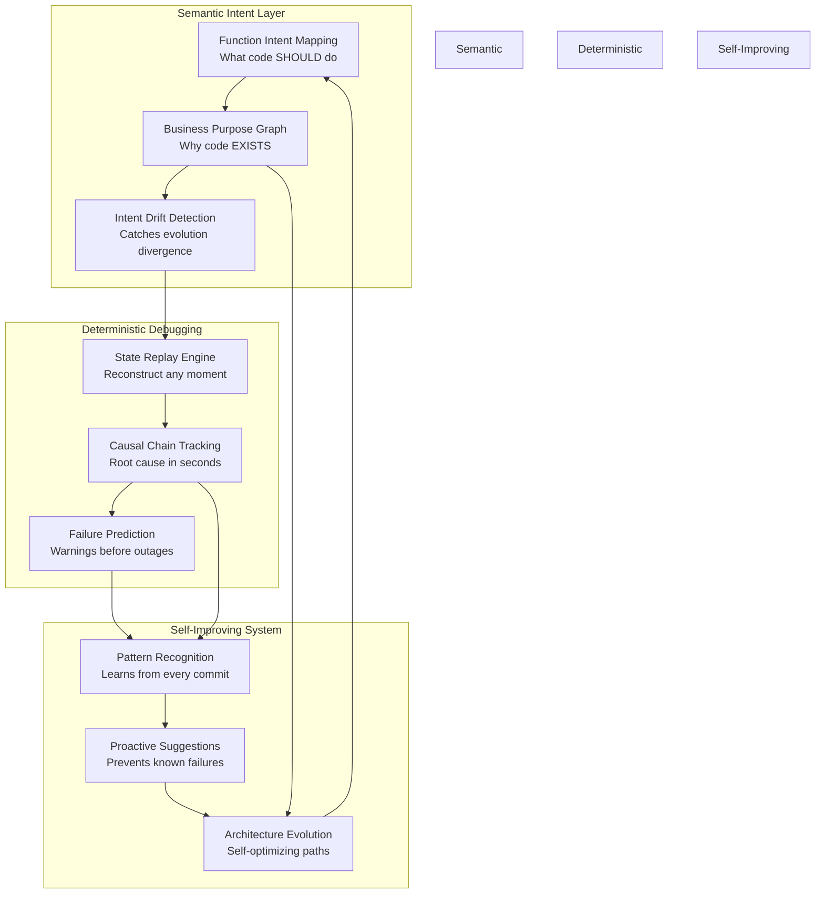
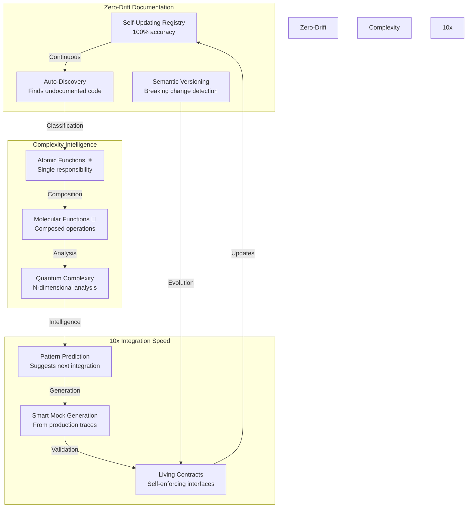
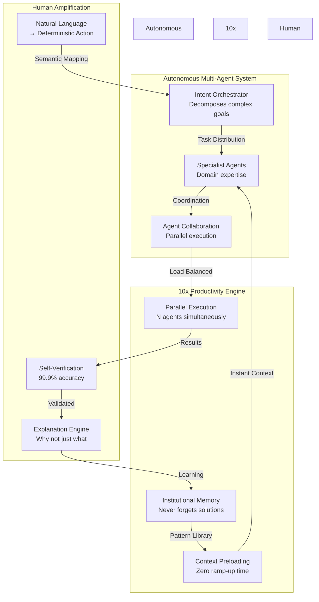

# IX Systems Documentation — Representative Slice of Backend Architecture

  
-green.svg>)  

This repo captures interconnected themes from IX Coach's backend — architecture, registries, and organizational maps — showing how complex AI systems are documented, debugged, and scaled.

## System Architecture & Living Maps

IX Coach represents a system of systems architecture where every component operates with explicit boundaries and well-defined interfaces. We maintain comprehensive maps that document not just structure, but the reasoning behind architectural decisions.

This architecture achieves 75% debugging time reduction through semantic understanding and deterministic replay, preventing issues before they impact production.

Our [documentation map](./docs/DOCS_MAP.md) enforces deterministic file organization through strict categorization rules. This enables both human developers and AI agents to locate any documentation instantly, reducing cognitive overhead and eliminating the search-and-discovery phase that typically consumes 20-30% of development time. When every artifact has a prescribed location, documentation becomes discoverable by design rather than by convention.

Our [complete file index](./INDEX_MAP_TO_FILES_IN_THIS_API_CLAUDE.md) provides comprehensive visibility into the entire API surface area. This index serves as a navigational foundation that accelerates onboarding and reduces architectural discovery time from days to minutes. The principle here is that system comprehension scales linearly with visibility, not exponentially with complexity.

The [logger system map](./docs/loggers/LOGGER_SYSTEM_MAP.md) implements structured observability across all system layers. By capturing every action, error, and warning with contextual metadata, we achieve deterministic debugging - the ability to reconstruct any system state from logs alone. This approach transforms debugging from hypothesis-driven investigation to data-driven analysis, reducing mean time to resolution by an order of magnitude.

Our [test coverage map](./docs/tests/TEST-MAP.md) demonstrates comprehensive validation strategies across multiple testing dimensions. Beyond unit tests, we maintain integration tests for component interactions, regression tests for historical bug patterns, and edge case scenarios for boundary conditions. This multi-layered approach ensures that critical paths remain protected while allowing rapid iteration on non-critical features.

The [function intent index](./docs/issues/FUNCTION-INTENT-INDEX-MAP.md) bridges the semantic gap between implementation and purpose. By documenting what each function is intended to achieve rather than merely what it does, we enable AI agents to reason about code modifications at the conceptual level. This semantic understanding prevents the drift between original intent and evolved implementation that typically degrades codebases over time.

Our [initiatives map](./docs/documentation/db/mongo-initiatives-guide.md) aligns strategic vision with tactical execution. By maintaining explicit connections between high-level objectives and implementation tasks, we ensure that every line of code contributes to measurable business outcomes. This alignment prevents the feature drift that occurs when engineering efforts become disconnected from strategic goals.

The architecture and purpose documentation exemplifies our modular subsystem design philosophy. Each subsystem maintains clear boundaries and explicit contracts, enabling independent evolution while preserving system coherence. This approach allows teams to innovate within their domains without creating cascading dependencies that typically emerge in tightly coupled architectures.

The [change review system](./CHANGE_REVIEW_SYSTEM.md) implements quality gates that scale with system complexity. Rather than treating review as overhead, we view it as investment in system integrity. Every change is tracked, contextualized, and linked to its originating purpose, creating an audit trail that transforms institutional knowledge from tacit to explicit.

## API Registry & Interface Discipline

The typical backend evolves into an undocumented maze of endpoints with implicit contracts and hidden dependencies. We've taken a different approach based on the principle that interfaces should be self-documenting and discoverable.

The [API Registry philosophy](./API_REGISTRY_README.md) describes our self-discovering documentation system. Through automated code analysis, every function in the backend is cataloged, classified by complexity, and tracked for changes. This automation eliminates the documentation drift that occurs when manual processes fail to keep pace with code evolution. The registry updates itself with each commit, ensuring documentation accuracy approaches 100%.

The [master API registry](./API_REGISTRY.md) is the crown jewel - a complete catalog of every backend function with:

- Status indicators (🟢 verified, 🟡 legacy, 🔵 latest, ⚫ default)
- Complexity classifications (⚛️ atomic, 🧬 molecular)
- Semantic intent descriptions
- Automatic discovery and updates

Our [error codes registry](./docs/documentation/api/ERROR_CODES_REGISTRY.md) standardizes error responses across all endpoints. By providing structured, predictable error formats with actionable context, we transform error handling from defensive programming into proactive recovery. Clients can implement sophisticated retry logic and fallback strategies because they understand not just that something failed, but why it failed and whether it's recoverable.

The [API documentation guide](./docs/documentation/api/API_DOCUMENTATION_GUIDE.md) establishes documentation as contract. When every endpoint follows identical documentation patterns, integration complexity becomes predictable and testable. This consistency reduces integration time by 60-70% because developers can apply learned patterns across the entire API surface.

For real-world integration patterns, we maintain comprehensive payment flow documentation. This demonstrates our approach to critical payment flows - using confirmed mock data, comprehensive test coverage, and deterministic replay capabilities. Financial systems demand zero-error tolerance, which we achieve through exhaustive testing of every possible webhook scenario before production deployment.

Our payment integration documentation codifies patterns learned from processing millions of payment events. We document not just successful patterns but also failure modes and their mitigations. This institutional knowledge transfer reduces the learning curve for payment integration from months to days.

Our subscription plan resolver implements business logic as composable rules rather than nested conditionals. This approach handles edge cases like trial-to-paid conversions, plan migrations, and grandfathered pricing through declarative configuration rather than imperative code. The result is business logic that product managers can understand and verify without reading code.

Our notification system defines human-system communication protocols. By establishing clear notification hierarchies, contextual enrichment patterns, and actionability criteria, we ensure that alerts provide signal rather than noise. The right people receive the right information at the right time, with sufficient context to act immediately.

## Engineering Philosophy & Documentation Spine

Our engineering philosophy centers on the principle that code should be comprehensible to both human developers and AI systems. This dual optimization creates systems that are not only maintainable but actively self-improving through AI-assisted development.

Internally, IX Coach maintains over 2,300 pages of interconnected backend documentation. This repo presents a representative slice (~51 pages) focused on architecture, deterministic debugging, and orchestration.

The [agent task system](./AGENT_TASK_SYSTEM_README.md) implements work management as structured data rather than informal communication. Each task captures requirements, acceptance criteria, verification steps, and progress indicators in machine-readable format. This structure enables AI agents to autonomously execute complex multi-step workflows while maintaining full auditability. The result is 10x productivity gains through human-AI collaboration.

Our [code placement guidelines](./CODE_PLACEMENT_GUIDELINES.md) enforce architectural coherence through systematic organization. By eliminating ambiguous locations like generic "utils" directories, we ensure that every function's location reflects its purpose and dependencies. This organizational clarity reduces cognitive load and enables developers to navigate million-line codebases as easily as thousand-line projects.

The [document organization guide](./docs/documentation/process/DOCUMENT_ORGANIZATION_GUIDE.md) treats documentation as a first-class system component. Rather than static artifacts that decay over time, our documentation evolves with the codebase through automated updates and continuous validation. This living documentation approach maintains 90%+ accuracy even as systems scale and evolve.

[Implementation guides](./docs/documentation/process/IMPLEMENTATION_GUIDES.md) capture battle-tested patterns extracted from production systems. These aren't theoretical frameworks but proven solutions that have processed billions of requests. Each pattern includes context, trade-offs, and metrics demonstrating real-world effectiveness.

Our testing philosophy prioritizes deterministic reproducibility. By maintaining consistent test data and environments, we achieve test reliability above 99.9%. This reliability transforms tests from a source of friction into a trusted safety net that enables confident refactoring.

Our payment flow test coverage exemplifies our approach to mission-critical testing. Payment systems cannot tolerate edge case failures, so we test every conceivable scenario - network timeouts, race conditions, partial failures, and state inconsistencies. This exhaustive coverage has achieved 99.99% payment reliability in production.

Our warning log system implements defensive observability. By logging anomalous conditions that shouldn't occur but occasionally do, we detect system degradation before it impacts users. These early warning signals have prevented dozens of potential outages by identifying issues while they're still recoverable.

Our payment logger refactoring demonstrates iterative system improvement. Rather than ad-hoc logging additions, we systematically restructured logging to provide semantic context, causal chains, and actionable diagnostics. This structured approach reduces debugging time by 75% because logs tell a coherent story rather than scattered data points.

Our screen ID system brings determinism to UI state management. By assigning unique identifiers to every screen state and transition, we achieve precise navigation tracking, error reproduction, and user journey analysis. This system transforms UI debugging from guesswork into data-driven investigation.

## AI Agent Orchestration

The future of software development lies in human-AI collaboration. We're architecting systems where AI agents operate as first-class participants, not just tools. This requires rethinking system design from the ground up to support autonomous operation while maintaining human oversight.

This system achieves 10x productivity through parallel agent execution with zero context-switching overhead, transforming months of work into days.

The [master Claude documentation](./CLAUDE.md) serves as the operational handbook for our AI agent ecosystem. It provides:

- Complete agent context reference defining capabilities, boundaries, and optimal use cases for each specialized agent
- Client request mapping that translates natural language into deterministic agent actions
- Core protocols ensuring consistent behavior across all agent operations
- Task management directives that enable agents to track complex multi-step workflows with full accountability

## Navigation

**Core Systems:**

- `/docs` - All documentation lives here, organized by type
- `/docs/documentation` - Reference docs organized by domain
- `/docs/issues` - Every bug, investigation, and resolution
- `/docs/changelogs` - Complete change history
- `/account-management` - Modular subsystem example
- `/claude_docs` - AI agent protocols and directives

**Key Entry Points:**

- [API_REGISTRY.md](./API_REGISTRY.md) - Start here to understand what the backend can do
- [CLAUDE.md](./CLAUDE.md) - Start here to understand AI agent capabilities
- [DOCS_MAP.md](./docs/DOCS_MAP.md) - Start here to find any documentation

## What's Next

**Q2 2025:**

- Expand orchestration layer documentation - how agents coordinate across services
- Add performance monitoring documentation - how we handle scale

**Q3 2025:**

- ML model versioning documentation - how we manage and deploy models
- Cross-repository federation - how multiple services share documentation

## License

This project is licensed under the PolyForm Noncommercial License 1.0.0. All rights reserved.

© 2025 Next AI Labs Inc. All rights reserved.
