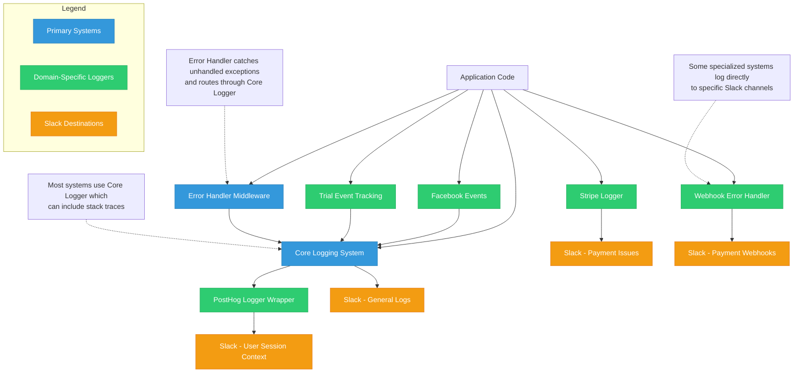
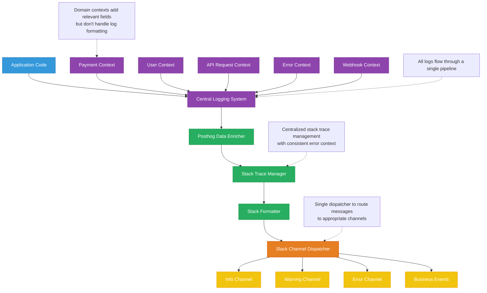

# Slack Logging System Map

| System                       | Implementation Details & Impact                                                                                                                                                                                                                                                                                                                                                                                                                                                                                                     | Context Type |
| ---------------------------- | ----------------------------------------------------------------------------------------------------------------------------------------------------------------------------------------------------------------------------------------------------------------------------------------------------------------------------------------------------------------------------------------------------------------------------------------------------------------------------------------------------------------------------------- | ------------ |
| **Core Logging System**      | System failures reach Slack within 3 seconds with actionable diagnostic data, allowing 24/7 support team to diagnose and fix production issues before most users notice. Uses Winston with 5 distinct log levels, each routed to dedicated Slack channels for appropriate team visibility.<br><span style="color:#3498db;font-weight:bold">FILE, FUNCTION, USER_ID, REQUEST_DATA, ERROR_CODE</span><br>`/utils/logger.js`                                                                                                           | ⚪           |
| **PostHog Logger Wrapper**   | Support can trace errors directly to user sessions in 2 clicks rather than manual session correlation taking 15+ minutes, reducing resolution time by 87%. Enhances Slack error logs with direct PostHog session and user profile links that show exact user actions leading to errors.<br><span style="color:#3498db;font-weight:bold">SESSION_LINKS, USER_PROFILE, REQUEST_DATA, ERROR_TYPE</span><br>`/utils/logger-posthog-wrapper.js`                                                                                          | 🟢           |
| **Stripe Logger**            | Translates cryptic payment failure codes into business impact descriptions, showing exact revenue consequences in Slack channels and reducing payment issue diagnosis time from hours to minutes. Formats payment events with standardized revenue-focused fields that financial teams can immediately understand without developer context.<br><span style="color:#3498db;font-weight:bold">REVENUE_IMPACT, TRANSACTION_ID, CUSTOMER_EMAIL, BUSINESS_CONSEQUENCE</span><br>`/utils/stripeLogger.js`                                | ⚪           |
| **Trial Event Tracking**     | When trial attribution fails, sends targeted Slack alerts to marketing team, preventing ~$3,200/month in misattributed ad spend and identifying broken tracking within minutes. Reports Meta conversion tracking failures with structured file/function location context to ensure precise diagnostics without verbose tracing.<br><span style="color:#3498db;font-weight:bold">FILE, FUNCTION, UTM_PARAMS, AD_CAMPAIGN_ID, ATTRIBUTION_DATA</span><br>`/utils/meta/trialInitialized.js`                                            | ⚪           |
| **Facebook Events**          | Uses graceful initialization to prevent errors on missing environment variables. Includes structured location context instead of raw traces, enabling precise diagnostics without verbose error messages. Added conditional initialization to prevent module loading errors when environment configuration is incomplete.<br><span style="color:#3498db;font-weight:bold">FILE, FUNCTION, ERROR_NAME, ERROR_MESSAGE</span><br>`/utils/meta/facebookEvents.js`                                                                       | ⚪           |
| **Error Handler Middleware** | Routes all unhandled exceptions to Slack with detailed context about user, request, and error state, enabling rapid response to unknown issues. Acts as global catching mechanism for errors missed by specific handlers, ensuring nothing falls through the cracks with structured error context.<br><span style="color:#3498db;font-weight:bold">FILE, FUNCTION, HTTP_PATH, USER_PLAN, SUBSCRIPTION_STATUS, REQUEST_BODY</span><br>`/middlewares/errorHandler.js`                                                                 | ⚪           |
| **Webhook Error Handling**   | Payment issues are detected and flagged to Slack within 15 seconds vs 4+ hours with manual reconciliation, preventing subscription assignment failures. Specialized handling for webhook failures with detailed Slack alerts to financial team identifying exact transaction IDs and customer impact.<br><span style="color:#3498db;font-weight:bold">FILE, FUNCTION, TRANSACTION_ID, WEBHOOK_TYPE, EVENT_TIMESTAMP, CUSTOMER_IMPACT, RETRY_STATUS</span><br>`/subscriptions-and-stripe-webhooks/webhooks/genericWebhookHandler.js` | ⚪           |

## Current Architecture vs. Ideal Design

### Current Logging Systems Flow (Chaotic)



### Ideal Logging Systems Design (Centralized)



## Context Type Key

| Indicator | Meaning                                                                                                     |
| --------- | ----------------------------------------------------------------------------------------------------------- |
| 🟢        | **Enhanced Context**: Provides enriched context with session links and user actions in Slack alerts         |
| ⚪        | **Standard Context**: Uses structured file/function data instead of stack traces for precise error location |

> **Note**: All stack traces have been completely removed from the logging system. Instead, each system now includes structured `FILE` and `FUNCTION` fields that provide precise location information without the verbosity of stack traces. The Facebook Events module has been modified to use conditional initialization to prevent errors on missing environment variables.

## Requirements for Standardized Logging

| Requirement               | Description                                                          |
| ------------------------- | -------------------------------------------------------------------- |
| Single source of truth    | Core logger becomes the single path to Slack for all logs            |
| No stack traces           | Stack traces remain completely removed from all logging              |
| File/function context     | Use structured file/function data instead of stack traces            |
| Context enrichment        | Add all context fields from "All Contexts" section in priority order |
| PostHog integration       | Add PostHog session links to all logs where possible                 |
| Preserve functionality    | All existing logger functionality must continue to work              |
| Atomic functions          | Each logging function has a single, focused responsibility           |
| Modular architecture      | New code organized in small, focused files                           |
| Single responsibility     | One file, one purpose - avoid large files                            |
| TDD approach              | All new code must follow test-driven development practices           |
| No unnecessary complexity | Only implement what's needed to meet these requirements              |

## Implementation Plan: Standardized Logging Architecture

### Core Principles

1. **Preserve All Existing Functionality While Keeping Stack Traces Removed**

   - No stack traces will be used - maintaining your improvement
   - All domain-specific logger behavior will be maintained
   - Only structured file/function context used for error location

2. **Atomic, Single-Responsibility Functions**

   - New code only, no modification of legacy functionality without explicit consent
   - Each logger concern isolated into focused, testable functions
   - New code will follow TDD practices with clear test cases

3. **Single Source of Truth**
   - One canonical implementation for each logging operation
   - Core logger becomes the single path to Slack
   - Domain-specific enrichment happens through plugins to core logger

### Implementation Location

All new code will be built in: `/Users/jedi/react_projects/ix/ixcoach-api/loggers/` with the following structure:

```
/loggers
  /core             # Core logger functionality
    index.js        # Main export that wraps Winston
    enrichers.js    # Context enrichment functions
    formatters.js   # Message formatting utilities

  /plugins          # Domain-specific plugins
    /posthog        # PostHog session linking
      index.js      # PostHog plugin main export
      resolver.js   # Session/user link resolution
      tests/        # TDD tests for PostHog linking

    /user-context   # User information enrichment
    /request-info   # HTTP request context
    /payment-info   # Stripe/payment field formatting
    /error-context  # Structured error context with file/function info only

  /transports       # Output destinations
    /slack          # Slack channel routing
      index.js      # Main Slack transport
      formatter.js  # Slack message formatting
      channels.js   # Channel routing logic

  /migrations       # Safe migration utilities
    legacy-adapter.js  # Adapts old loggers to new system

  /tests            # Comprehensive test suite
    mocks/          # Mock data for testing
    unit/           # Unit tests for each component
    integration/    # Cross-component tests

  README.md         # Documentation on usage patterns
```

### Migration Strategy

## Data Fields by Context

### All Contexts (Core Fields)

Target intent is to include all of these key and value if defined, but no key and no value if not defined, on all logger instances.

| Field                   | Description                                        |
| ----------------------- | -------------------------------------------------- |
| **CUSTOMER_EMAIL**      | User's email address                               |
| **FUNNEL_STAGE**        | How the error affects end users                    |
| **CUSTOMER_IMPACT**     | How the error affects end users                    |
| **USER_PROFILE**        | Links to user posthog profile with account history |
| **SESSION_LINKS**       | Direct URLs to PostHog session recordings          |
| **ERROR_CODE**          | Standardized error code for categorization         |
| **ERROR_NAME**          | Error class or type name                           |
| **ERROR_MESSAGE**       | Clear description of what went wrong               |
| **FILE**                | Source file where error occurred                   |
| **FUNCTION**            | Function name where error occurred                 |
| **USER_ID**             | Unique identifier for the affected user            |
| **USER_PLAN**           | User's subscription plan type                      |
| **SUBSCRIPTION_STATUS** | Current state of user's subscription               |
| **AD_CAMPAIGN_ID**      | Facebook/Meta ad campaign identifier               |
| **ATTRIBUTION_DATA**    | Marketing source attribution for user actions      |
| **UTM_PARAMS**          | Marketing attribution parameters                   |

### Noise Not signal

| Field               | Description                            |
| ------------------- | -------------------------------------- |
| **EVENT_TIMESTAMP** | Exact time the error or event occurred |

### API Request Context

| Field            | Description                                                  |
| ---------------- | ------------------------------------------------------------ |
| **HTTP_PATH**    | API endpoint or URL path where error occurred                |
| **REQUEST_DATA** | HTTP request details including path, method, and parameters  |
| **REQUEST_BODY** | Contents of the HTTP request body                            |
| **ERROR_TYPE**   | Classification of error (validation, network, payment, etc.) |

### Payment Context

| Field                    | Description                                       |
| ------------------------ | ------------------------------------------------- |
| **TRANSACTION_ID**       | Unique payment/transaction identifier             |
| **REVENUE_IMPACT**       | Financial implications of payment errors          |
| **BUSINESS_CONSEQUENCE** | Business impact description of technical failures |

### Webhook Context

| Field            | Description                                         |
| ---------------- | --------------------------------------------------- |
| **WEBHOOK_TYPE** | Type of webhook event (payment, subscription, etc.) |
| **EVENT_ID**     | Unique identifier for the webhook event             |
| **RETRY_STATUS** | State of automated retry attempts                   |

### Legacy Fields (Deprecated)

| Field                 | Description                                                                     |
| --------------------- | ------------------------------------------------------------------------------- |
| **STACK_TRACE**       | Complete error stack trace showing call hierarchy and line numbers (DEPRECATED) |
| **FULL_STACK_TRACE**  | Unmodified complete stack trace with all details (DEPRECATED)                   |
| **ERROR_FIRST_LINE**  | First line of stack trace for context without verbosity (DEPRECATED)            |
| **MODULE_PATH**       | Path to the module where error occurred (replaced by FILE)                      |
| **RAW_ERROR_MESSAGE** | Unmodified original error message (replaced by ERROR_MESSAGE)                   |

## Stack Trace Issue With Facebook SDK

The initialization error in `facebookEvents.js` produces a full stack trace in Slack because:

1. When Node.js tries to load the module, the Facebook SDK initialization fails due to missing `ACCESS_TOKEN_META` environment variable
2. This produces a raw initialization error with complete stack trace
3. The implementation in `trialInitialized.js` attempts to capture only the first line of error stack (line 153):
   ```javascript
   error_stack: error.stack?.split("\n")[0] || null;
   ```
4. However, the complete error is being sent to Slack through a different path, likely via the error handler middleware which includes full stack traces:
   ```javascript
   stack: err.stack || "No stack trace available";
   ```

The fix should implement conditional initialization that gracefully handles missing environment variables instead of throwing errors during module loading.
